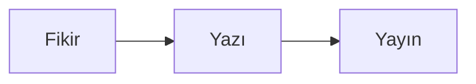

# mirza-blog

Kişisel blog. Statik site: Markdown yazılar + Astro. Veritabanı, sunucu tarafı kod, çerez yok.

## Gereksinimler

- Node.js >= 20 (bu proje Node 24 ile geliştirildi)

## Komutlar

```bash
npm install
npm run dev      # http://localhost:4321
npm run build    # dist/ üretir
npm run preview  # build çıktısını lokalde sunar
npm run check    # TypeScript + Astro kontrolü
```

## Yeni yazı ekleme

`src/content/blog/` altına bir `.md` dosyası koy. Dosya adı URL olur:
`ilk-yazim.md` → `/yazilar/ilk-yazim/`.

```yaml
---
title: 'Yazı başlığı'
description: 'Listede ve arama sonuçlarında görünen tek cümlelik özet.'
date: 2026-10-24
tags: ['etiket']
cover: ./kapak.png        # opsiyonel; src/assets/ içindeki bir görsel
coverAlt: 'Görselin alternatif metni'
draft: false              # true ise yazı yayınlanmaz
---
```

Gövdede normal Markdown kullanılır. Görseller `src/assets/` içinde durur ve
build sırasında otomatik olarak boyutlandırılır (WebP/AVIF).

## Diyagram ekleme

````markdown

````

Bu bloklar build sırasında [pele](https://pele.run) ile SVG'ye çevrilir
(`src/lib/rehype-pele.mjs`). Okuyucuya diyagram motoru indirilmez.

- Her diyagram iki kez çizilir: geniş ve dar. 720px altında dikey yerleşimli
  sürüm gösterilir (`src/styles/global.css`).
- Flowchart oklarında CSS ile akan kesik çizgi animasyonu var; hareket
  hassasiyeti olan okuyucularda kapanır.
- Yanlış sözdizimi build'i durdurur ve hangi dosyada olduğunu söyler.
- Bir diyagram tipi desteklenmezse `pele` yerine `rehype-mermaid` kullanmak
  mümkün; yazılar değişmez, sadece `astro.config.mjs` değişir.

## Yayına alma

Site tamamen statik. `dist/` klasörünü herhangi bir statik sunucuya koyabilirsin
(Cloudflare Pages, nginx, Caddy, GitHub Pages...).

**Domain bağlarken tek yer:** `src/config.ts` içindeki `SITE.url`. RSS, canonical
linkler ve Open Graph etiketleri oradan üretiliyor.

## Yapı

```
src/
  config.ts              site başlığı, açıklama, adres
  content.config.ts      yazı şeması (frontmatter doğrulaması)
  content/blog/*.md      yazılar
  assets/                yazı görselleri
  layouts/BaseLayout.astro
  components/            header, footer
  lib/rehype-pele.mjs    mermaid → SVG
  pages/
    index.astro          yazı listesi
    yazilar/[...slug].astro
    hakkinda.astro
    404.astro
    rss.xml.ts
  styles/global.css      tüm tasarım
```

## Tasarım notları

- Gövde serif, arayüz öğeleri sans-serif; satır uzunluğu ~68 karakter.
- Tek vurgu rengi. Karanlık mod `prefers-color-scheme` ile otomatik.
- Renkler `src/styles/global.css` içindeki değişkenlerde; değiştirmek için
  tek yer var.
