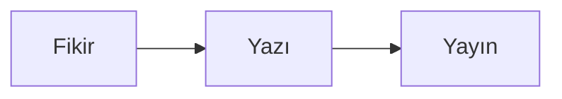

# mirza-blog

Kişisel blog. Statik site: Markdown yazılar + Astro. Veritabanı, sunucu tarafı kod, çerez yok.

## Gereksinimler

- Node.js >= 22.23.4 (Astro 7'nin alt sınırı)

## Komutlar

```bash
npm install
npm run dev      # http://localhost:4321
npm run build    # dist/ üretir
npm run preview  # build çıktısını lokalde sunar
npm run check    # TypeScript + Astro kontrolü
```

## Yeni yazı ekleme

`src/content/blog/` altına bir dosya koy. Dosya adı URL olur:
`ilk-yazim.md` → `/yazilar/ilk-yazim/`.

Varsayılan `.md`. İçinde bir Astro bileşeni kullanacaksan `.mdx` yap
(örnek: `ascii.mdx`) ve gövdenin en üstünde import et.

```yaml
---
title: 'Yazı başlığı'
description: 'Listede ve arama sonuçlarında görünen tek cümlelik özet.'
date: 2026-10-24
tags: ['etiket']
cover: ../../assets/kapak.png   # opsiyonel; src/assets/ içindeki görsel
coverAlt: 'Görselin alternatif metni'  # cover varsa zorunlu
draft: false                     # true ise yazı yayınlanmaz
---
```

Gövdede normal Markdown kullanılır. Görseller `src/assets/` içinde durur ve
build sırasında WebP olarak yeniden boyutlandırılır.

### Taslak akışı

`draft: true` iken yazı **yalnızca `npm run dev` sırasında** görünür: ana
sayfada "taslak" rozetiyle listelenir ve `/yazilar/<slug>/` açılır. `npm run
build` taslakları hiç üretmez, RSS'e de girmez. Yayına almak için `draft`
satırını sil (veya `false` yap).

## Diyagram ekleme

````markdown

````

Bu bloklar build sırasında [pele](https://pele.run) ile SVG'ye çevrilir
(`src/lib/remark-pele.mjs`). Okuyucuya diyagram motoru indirilmez.

- `accTitle` (ve istersen `accDescr`) ekran okuyucu için gereklidir; yoksa
  build sırasında uyarı çıkar. pele bunları SVG `<title>`/`<desc>` olarak basar.
  `accTitle` desteklemeyen tiplerde (block, C4, kanban, mindmap) blok başlığına
  `title="…"` yazılır; eklenti bunu `aria-label` olarak basar.
- Her diyagram iki kez çizilir: geniş ve dar. 672px altında dikey yerleşimli
  sürüm gösterilir (`src/styles/global.css`).
- 700px'den geniş diyagramlar küçülmek yerine yatay kaydırılır; kabul ediyorsan
  bloğa `wide` ekleyip uyarıyı susturabilirsin.
- Flowchart oklarında CSS ile akan kesik çizgi animasyonu var; hareket
  hassasiyeti olan okuyucularda kapanır. pele'nin kendi kesikli kenarları
  animasyona dahil edilmez.
- Yanlış sözdizimi build'i durdurur ve hangi dosyada olduğunu söyler.
- Bir diyagram tipi desteklenmezse `pele` yerine `rehype-mermaid` kullanmak
  mümkün; yazılar değişmez, sadece `astro.config.mjs` değişir.

## ASCII sanatı (ascii.rest)

`ascii.rest` bileşeni yalnızca `.mdx` içinde kullanılabilir:

```mdx
import Ascii from 'ascii.rest/astro';

<Ascii piece="deep-reef" label="Mercan kayalığı" />
<Ascii piece="terminal" mono label="Bir terminal penceresi" />
```

- Renkli parça `<canvas>` olarak çizilir; JavaScript çalışmadan yer tutucu kutu
  görünür. Ana sayfadaki hero da bu bileşeni kullanır: `ocean-sunset` canvas'ı ve
  JavaScript kapalıyken görünen `<noscript>` terminal kartı.
- `mono` parça `<pre>` olarak sunucuda basılır; JavaScript kapalıyken de
  görünür ve tema rengini alır.
- Parça adları: `npx ascii.rest list`.
- Build çıktısına her parça için bir JS dosyası düşer (~217 dosya); tarayıcı
  yalnızca sayfada kullanılanı indirir.

## Diller

- Türkçe yazılar: `src/content/blog/*.md` → `/yazilar/<slug>/`
- İngilizce yazılar: `src/content/blog/en/*.md` → `/en/<slug>/`
- Dil, dosya yolundan türetilir; frontmatter'da ayrıca `lang` yazılmaz.
- `translationKey` aynı olan iki dosya birbirinin çevirisi sayılır. Sayfada dil
  bağlantısı ve `<head>` içinde `hreflang` üretilir.
- Her yazının çevirisi olmak zorunda değil. Çevirisi olmayan yazıda dil bağlantısı
  o dilin ana sayfasına gider.
- Arayüz metinleri `src/i18n.ts` içinde; rota ve şablonlar `lang` geçirir.
- RSS: `/rss.xml` (TR) ve `/en/rss.xml` (EN).
- URL üretmek için `postUrl()` kullan; elle yol yazma.

## Yayına alma

Site tamamen statik (`dist/`, 10 sayfa, ~1.7 MB). İki kurulu yol var; ikisi de
aynı çıktıyı kullanır, yalnızca sunum katmanı değişir.

### A) Cloudflare Pages (önerilen)

Statik içerik CDN'den sunulur; dizüstü kapalıyken de site ayakta kalır,
her push'ta otomatik yayın ve geri alma (rollback) vardır.

Dashboard'da tek seferlik:

1. Cloudflare → Workers & Pages → Create → Pages → **Connect to Git**.
2. Depo: `PlaneInABottle/mirza-blog`, üretim dalı `main`.
3. Framework: Astro · Build command: `npm run build` · Output: `dist`
4. Proje adı: `mirza-blog` (`wrangler.toml` ile aynı olmalı).
5. Custom domains → domaini ekle (zone zaten Cloudflare'deyse CNAME'i kendi kurar).

Node sürümü `engines` ve `.nvmrc` ile 22'ye sabit; Pages varsayılanı daha
eskisi olabilir, build log'unda Node sürümünü bir kez doğrula.

CLI'dan yayınlamak istersen (Git entegrasyonu yerine):

```bash
wrangler login                       # tarayıcıda OAuth, bir kez
npm run build
wrangler pages deploy dist --project-name mirza-blog
```

`public/_headers` bu yolda etkindir: `/_astro/*` bir yıl `immutable`,
sayfalar `nosniff` + `Referrer-Policy` ile sunulur. `404.html` otomatik
kullanılır.

### B) Kontrol PC'de tunnel + statik sunucu

Mevcut ev lab düzeniyle aynı (kozmopath, divingbuddies): site, laptop açıkken
yayında olur. Dinamik bir parça (yorum servisi gibi) gerekirse zaten bu yol
kullanılacak.

```bash
# 1) statik sunucu (Caddy host'ta kurulu)
sudo mkdir -p /srv/www/mirza-blog && sudo chown "$USER" /srv/www/mirza-blog
npm run build && rsync -a --delete dist/ /srv/www/mirza-blog/

# 2) tunnel ingress (yedek al, sonra düzenle)
cp ~/.cloudflared/config.yml ~/.cloudflared/config.yml.pre-blog-$(date +%Y%m%dT%H%M%S)
#    - hostname: <domain>
#      service: http://127.0.0.1:8088
cloudflared tunnel ingress validate
systemctl --user restart cloudflared-kozmopath

# 3) DNS kaydı (cert.pem ile, dashboard gerekmez)
cloudflared tunnel route dns kozmopath-home-server <domain>
```

Bu yolda `_headers` yok sayılır; aynı başlıkları Caddyfile'da vermek gerekir.

### Domain

- Kayıt: Squarespace Domains · DNS: Cloudflare (`vida/santino.ns.cloudflare.com`)
- Apex `https://ymirzaaltay.com` ana adres, `www` ona yönlendirilecek.

**Tek kaynak:** `src/config.ts` içindeki `SITE.url`. `astro.config.mjs` bu değeri
import ederek `site` alanına veriyor; canonical, `hreflang`, Open Graph, RSS ve
sitemap hepsi oradan üretiliyor. Adres değişirse yalnızca o satır değişir.

- `sitemap-index.xml` + `sitemap-0.xml`: `@astrojs/sitemap` build sırasında üretir
  (draft ve 404 hariç).
- `robots.txt` (`public/`) sitemap'i işaret eder; domain değişirse oradaki adres de
  güncellenmeli.

## Yapı

```
src/
  config.ts              site başlığı, açıklama, adres
  i18n.ts                arayüz metinleri (tr/en)
  content.config.ts      yazı şeması (frontmatter doğrulaması)
  content/blog/*.md      Türkçe yazılar
  content/blog/en/*.md   İngilizce yazılar
  assets/                yazı görselleri
  layouts/BaseLayout.astro
  components/            hero, header, footer
  lib/remark-pele.mjs    mermaid → SVG (remark aşaması)
  lib/posts.ts           yazı listesi, dil, çeviri eşleşmesi
  lib/feed.ts            RSS (tr/en)
  pages/
    index.astro          yazı listesi (TR)
    yazilar/[...slug].astro
    hakkinda.astro
    en/index.astro       yazı listesi (EN)
    en/[...slug].astro
    en/about.astro
    en/rss.xml.ts
    404.astro
    rss.xml.ts
  styles/global.css      tüm tasarım
```

## Tasarım notları

- Gövde serif, arayüz öğeleri sans-serif. Kolon `42rem` (672px), metin alanı
  632px; satır uzunluğu ~70 karakter.
- Tek vurgu rengi. Karanlık mod `prefers-color-scheme` ile otomatik.
- Renkler `src/styles/global.css` içindeki değişkenlerde; değiştirmek için
  tek yer var.
