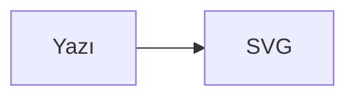
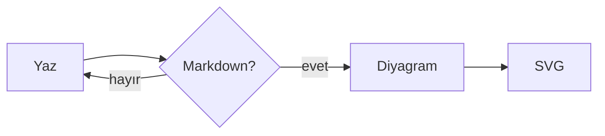
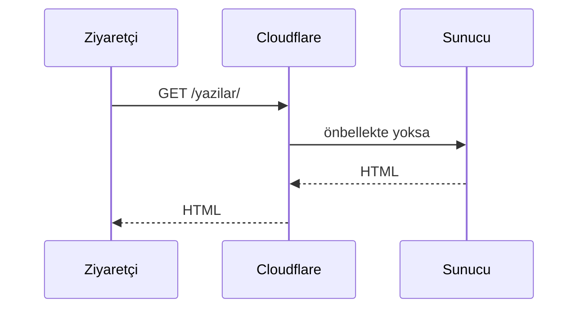

Diyagramlar bu blogda bir görsel değil, yazının parçası. Bu yüzden onları ekran görüntüsü olarak değil, doğrudan Markdown içine yazıyorum:

````markdown

````

Site build edilirken `mermaid` kod blokları [pele](https://pele.run) ile SVG'ye çevriliyor. Yani sayfayı açan kişiye diyagram motoru indirmiyorum; ortaya çıkan şey düz bir `<svg>`.

## Bir akış

Aşağıdaki diyagramın okları akıyor — CSS ile, JavaScript olmadan. Hareket hassasiyeti olan okuyucularda animasyon otomatik olarak kapanıyor.



Diyagramlar `flowchart LR` gibi yatay yazıldığında geniş ekranda yatay, telefonda ise dikey yerleşime geçiyor. Yani küçük ekranda küçülen bir resim değil, yeniden düzenlenmiş bir diyagram görüyorsun.

## Sıra diyagramı

Aynı sözdizimi, farklı diyagram tipi:



## Neden böyle

İki alternatif vardı: diyagramı tarayıcıda çizmek (sayfaya ~1.6 MB JavaScript) ya da build sırasında headless tarayıcı çalıştırmak (build başına ekstra bağımlılık). Pele ikisini de gerektirmiyor: saf JavaScript, tarayıcısız, çıktısı tema değişkenleriyle renklenen SVG.

Sonuç: sayfa ağırlığı değişmiyor, diyagram karanlık moda uyuyor ve JavaScript kapalıyken de görünüyor.
