Diyagramı ekran görüntüsü olarak değil, doğrudan Markdown'a yazabilirsin:

````markdown
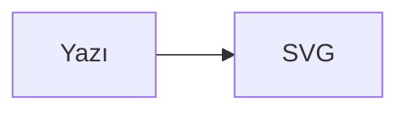
````

Build sırasında `mermaid` blokları [pele](https://pele.run) ile SVG'ye çevriliyor. Okuyucuya diyagram motoru indirmiyorsun; ortaya düz bir `<svg>` çıkıyor. Aşağıda desteklenen tiplerin tamamı, her biri çalışan bir örnekle duruyor.

## Erişilebilir ad: accTitle ve title

Ekran okuyucu bir SVG'yi "isimsiz grafik" olarak duyurmasın diye diyagrama ad ver. İki yol var:

- Tip `accTitle` destekliyorsa blok içine `accTitle: …` (ve istersen `accDescr: …`) yaz. pele bunları `<title>` ve `<desc>` etiketlerine çevirir.
- Tip desteklemiyorsa (block, C4, kanban, mindmap) blok başlığına `title="…"` ekle; eklenti bunu SVG'ye `aria-label` olarak basar.

Ad vermezsen build sırasında uyarı çıkar.

## Tip kataloğu

| Tip | Erişilebilir ad | Genişlik / not |
| --- | --- | --- |
| `flowchart` | `accTitle` | Kolona sığar, mobilde yeniden yerleşir |
| `block-beta` | `title="…"` | Kutulu yerleşim |
| `sequenceDiagram` | `accTitle` | Katılımcı + mesaj |
| `journey` | `accTitle` | Yolculuk/deneyim |
| `classDiagram` | `accTitle` | Sınıf ve ilişki |
| `stateDiagram-v2` | `accTitle` | Durum geçişi |
| `erDiagram` | `accTitle` | Varlık-ilişki |
| `requirementDiagram` | `accTitle` | Gereksinim |
| `C4Context` | `title="…"` | Sistem bağlamı |
| `architecture-beta` | `accTitle` | Servis/grup mimarisi |
| `pie` | `accTitle` | Pay dağılımı |
| `quadrantChart` | `accTitle` | İki eksenli konumlandırma |
| `xychart-beta` | `accTitle` | Çubuk/çizgi grafik |
| `treemap-beta` | `accTitle` | Hiyerarşik alan |
| `sankey-beta` | `accTitle` | Akış hacmi |
| `packet-beta` | `accTitle` | Paket alanları, çok geniş |
| `gantt` | `accTitle` | Takvim, geniş |
| `timeline` | `accTitle` | Zaman çizgisi |
| `gitGraph` | `accTitle` | Commit akışı |
| `kanban` | `title="…"` | Pano |
| `mindmap` | `title="…"` | Dallanan başlıklar |

## Akış diyagramı

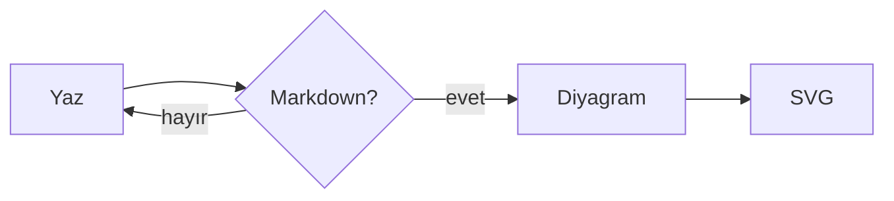

## Blok yerleşimi

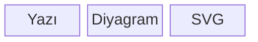

## Sıra diyagramı

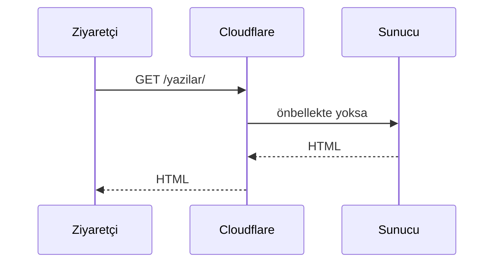

## Yolculuk

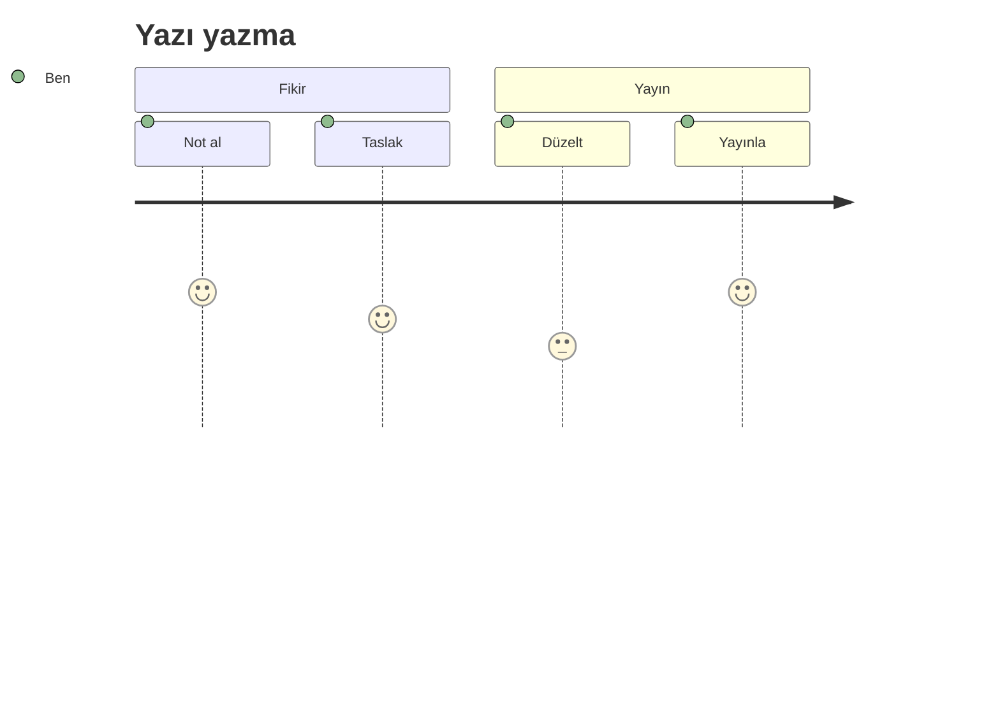

## Sınıf diyagramı

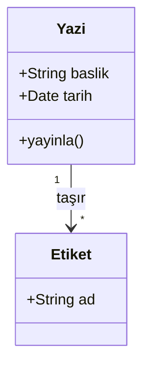

## Durum diyagramı

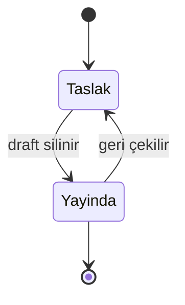

## Varlık-ilişki diyagramı

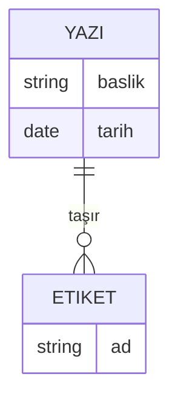

## Gereksinim diyagramı

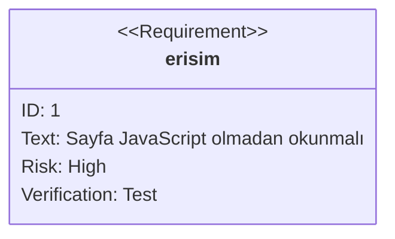

## C4 bağlam diyagramı

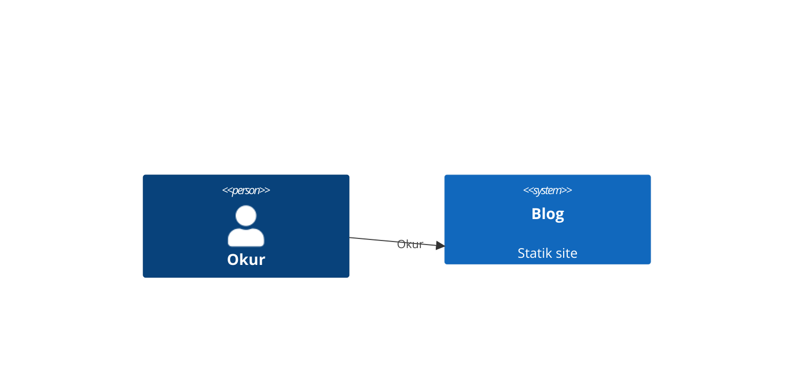

## Mimari diyagramı

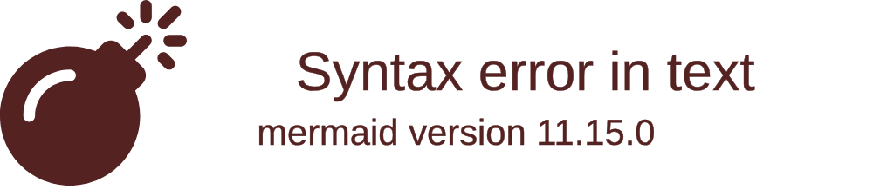

## Pasta grafiği

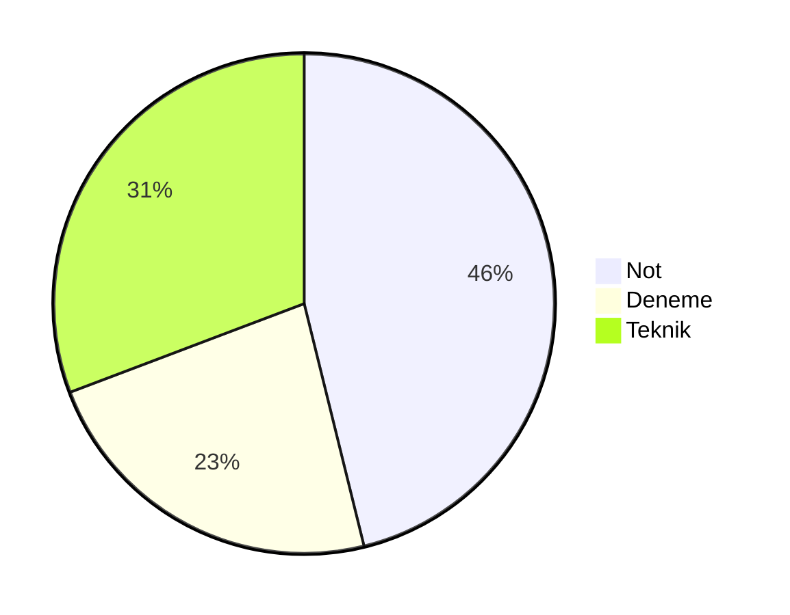

## Kadran grafiği

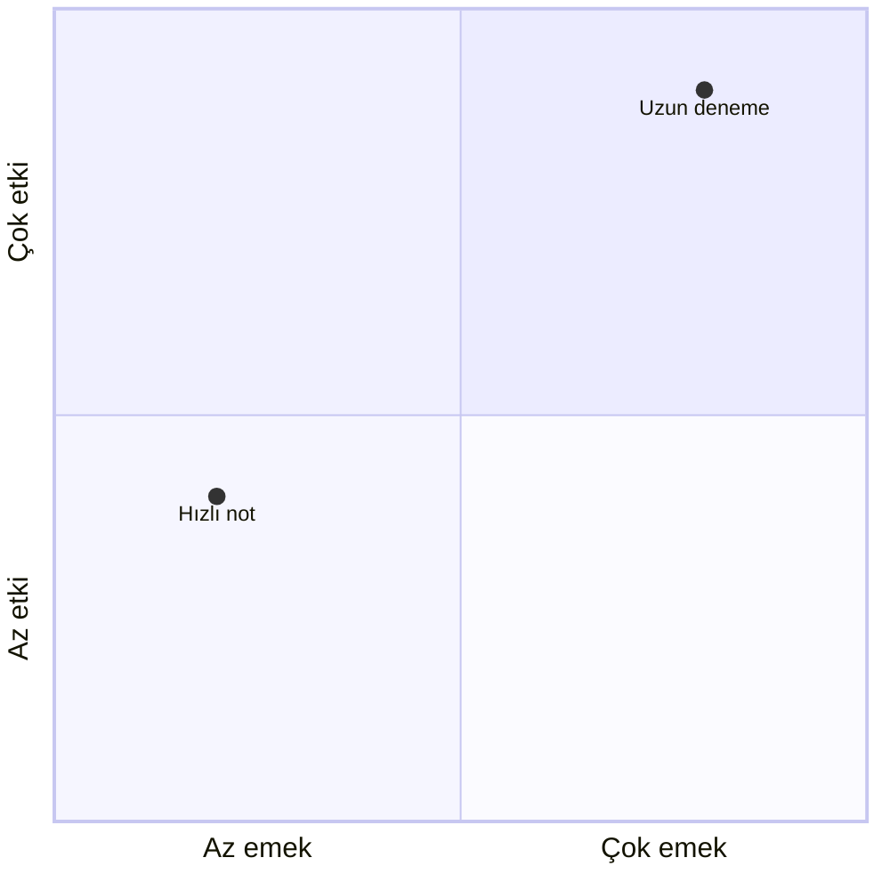

## XY grafiği

Eksen etiketlerinde Türkçe karakter kullanacaksan tırnak içine al.

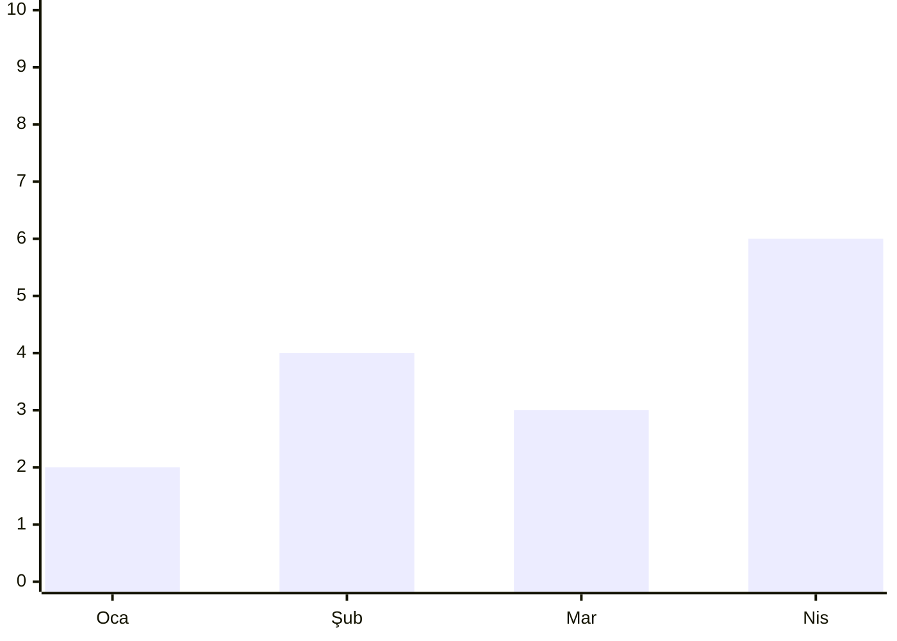

## Ağaç haritası

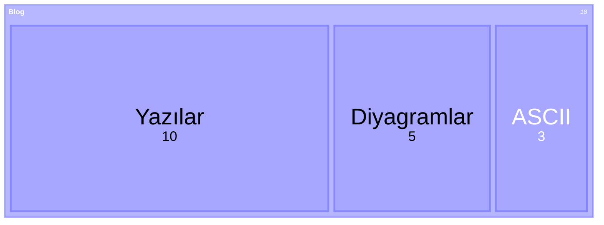

## Sankey

```mermaid
sankey-beta
  Yazı,Okur,30
  Yazı,Arama,20
  Okur,Paylaşım,10
```

## Paket yapısı

Kolona sığmadığı için yatay kaydırılıyor.

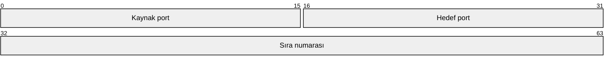

## Gantt

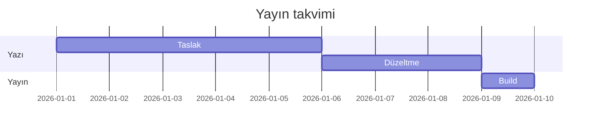

## Zaman çizgisi

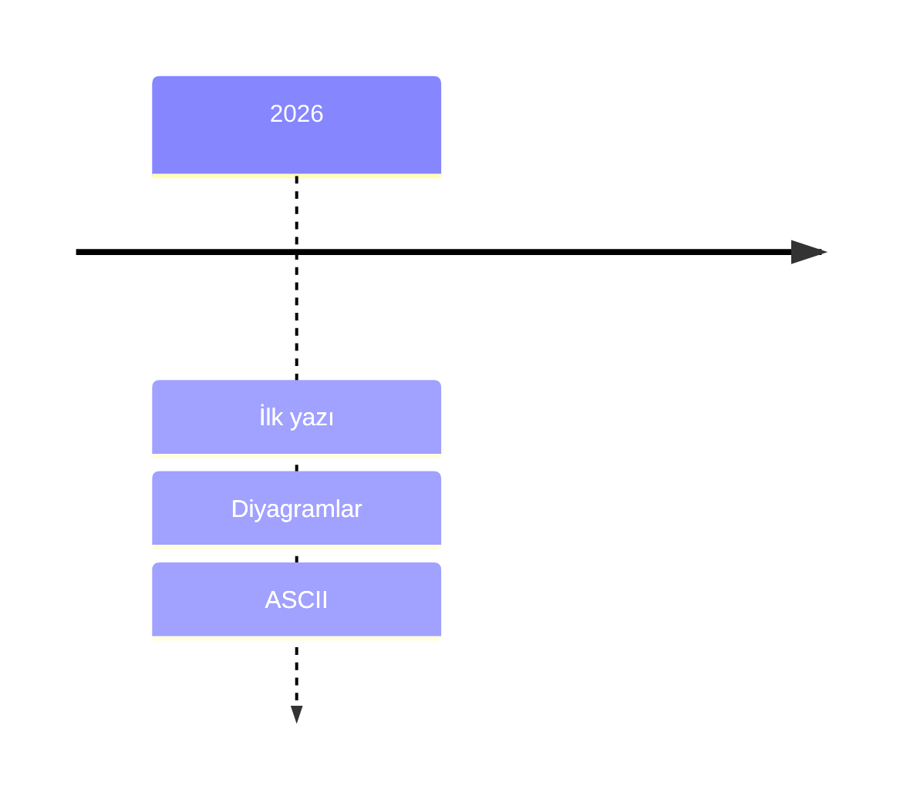

## Commit grafiği

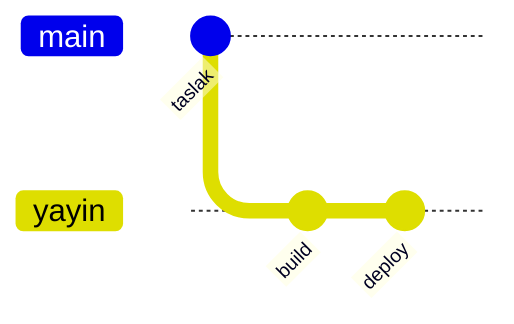

## Kanban

```mermaid title="Yayın panosu"
kanban
  Taslak
    yazi1[İlk yazı]
  Yayında
    yazi2[Diyagramlar]
```

## Zihin haritası

```mermaid title="Zihin haritası"
mindmap
  root((Blog))
    Notlar
    Denemeler
    Teknik
```

## Genişlik ve mobil

Metin kolonu ~632 piksel. 700 pikselden geniş diyagramlar `diagram--scroll` sınıfını alır ve küçülmek yerine **yatay kaydırılır**; böylece yazı okunmaz hâle gelmez. Bu durumda build uyarı verir; kabul ediyorsan bloğa `wide` ekleyip uyarıyı susturabilirsin.

Her diyagram iki kez çiziliyor: geniş ve dar (dikey yerleşimli). 672 pikselin altında dar sürüm gösteriliyor, yani telefonda küçülen bir resim değil, yeniden düzenlenmiş bir diyagram görüyorsun.

## Ok animasyonu

Flowchart oklarında CSS ile akan kesik çizgi animasyonu var — JavaScript olmadan. Hareket hassasiyeti olan okuyucularda animasyon otomatik kapanıyor. pele'nin kendi kesikli kenarları bu animasyona dahil edilmiyor.

## Neden pele

İki alternatif var: diyagramı tarayıcıda çizmek (sayfaya ~1.6 MB JavaScript) ya da build sırasında headless tarayıcı çalıştırmak (build başına ekstra bağımlılık). pele ikisini de gerektirmiyor: saf JavaScript, tarayıcısız, çıktısı tema değişkenleriyle renklenen SVG.

Yanlış sözdizimi build'i durduruyor ve hangi dosyada olduğunu söylüyor. Bir tip desteklenmezse `pele` yerine `rehype-mermaid` gibi bir alternatife geçebilirsin; yazılar değişmiyor, sadece `astro.config.mjs` değişiyor.
