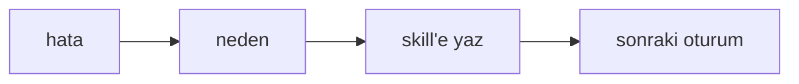
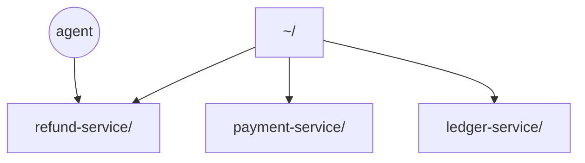
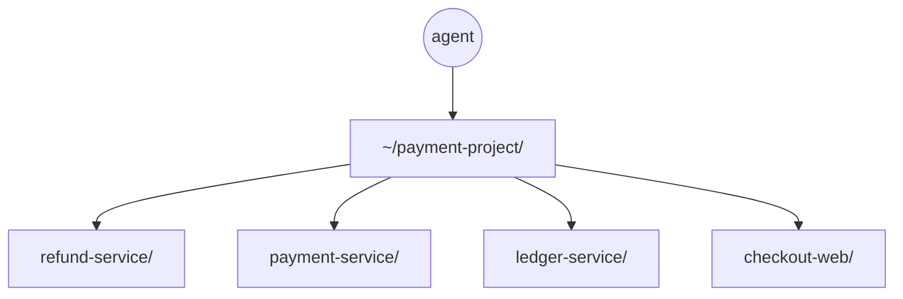

Yapay zekâ, en iyi çalıştığı ortamı ona göre düzenlediğinizde sonuç veriyor. Elbette bir yazılım projesinde ona sadece kod yazdırıyor olabilirsiniz, ama asıl değer, bu kodun çalıştığı servisi ve varsa database gibi bağımlılıklarını ayağa kaldırıp bir özelliği uçtan uca test etmesinde yatıyor. Bu yazıda kendi uyguladığım yöntemlerden bahsedeceğim.

## AGENTS.md ve skill'ler

AGENTS.md'yi, Claude kullanıyorsanız CLAUDE.md'yi bildiğinizi varsayıyorum. AGENTS.md kısaca, bir dizinde çalışırken oradaki proje hakkında AI'ın başlarken sistemine yüklediği bir dosya.

Skill'leri de benzer şekilde tanımlayabiliriz ama önemli bir ayrımları var: skill'leri AI dinamik olarak, isteyince okuyup sistemine alıyor. Aslında bu skill'lerin ne kadar etkili olduğunu anlatmakla bitiremem.

Öncelikle skill'ler AI'ın context'ine yüklenmediği zaman neredeyse hiç yer kaplamıyor; sadece skill dosyalarının başındaki açıklama yükleniyor:

```markdown
---
name: refund-flow
description: İade talebinin refund-service, payment-service ve ledger-service arasında nasıl ilerlediğini anlatır. İade akışına dokunan her değişiklikte oku.
---
```

AI da zaten açıklamaya göre, karşılaştığı durumda skill'i çağırıp çağırmamaya karar veriyor. Küçük yer kaplamasının en büyük avantajı şu: her duruma özgü onlarca skill dosyanız olabilir. Ben genelde projedeki temel şeyleri skill'lere dökmeye çalışıyorum. Örnek olarak payment üzerine kurulu bir projede şu skill dosyaları var (proje ismini örnek olsun diye `payment-project` diyeceğim):

| Skill             | Ne zaman okunur                                                  |
| ----------------- | ---------------------------------------------------------------- |
| `refund-flow`     | İade akışına dokunan her değişiklikte; üç servis arasındaki sıra |
| `payment-capture` | Capture ve pre-auth mantığı değiştiğinde                         |
| `ledger-currency` | Para birimi ve kur dönüşümü işin içine girdiğinde                |
| `local-runtime`   | Servisleri ayağa kaldırmak ya da loglara bakmak gerektiğinde     |
| `jira-task`       | Task'ın kabul kriterlerini ve Jira geçmişini toplarken           |

Burada skill dosyalarının içeriğini de olabildiğince spesifik ve özelleştirilmiş tutmak önemli. İstediğiniz kadar skill dosyası oluşturabilirsiniz; bir tanesinin içine onlarca farklı konuyu yığmaya gerek yok, o noktada bütün avantajını kaybetmiş olursunuz. Yani ne kadar çok skill dosyanız olursa o kadar iyi.

## Bakım yükü ve geri bildirim döngüsü

Tabii bu kadar skill dosyası ve AGENTS.md beraberinde büyük bir bakım yükü getiriyor. Benim en çok kullandığım yöntem şu: herhangi bir task'ı yaptıktan sonra (Jira'daki bir task olsun, kendi karar verdiğim bir konu olsun) session'ı kapatmadan, ya da belki session ortasında, AI'a her zaman takıldığı yerleri not almasını, bunların bir daha yaşanmaması için skill'leri ve AGENTS.md'yi güncellemesini, gerekiyorsa yeni skill oluşturmasını yazıyorum:

> takıldığın yerleri not al, neden takıldığını çıkar, bir daha yaşanmaması için skill'leri ve AGENTS.md'yi güncelle, gerekiyorsa yeni bir skill oluştur



Bu ufak gibi görünen şey aslında AI için hayati öneme sahip olabiliyor. Çünkü AI çalışırken basit bir işi bile çoğu zaman 3-4 farklı bash komutu çalıştırdıktan sonra doğrulayabiliyor; bu, database'de bir table aramak olabilir, servisleri ayağa kaldırmak olabilir. Burada AI karanlıkta ilerlediği için deneme yanılma yaparak bir şeyleri buluyor ya da bilmediklerini yolda keşfediyor.

AI'a hatalarından ders almasını söylemek bu noktada çok değerli. İlk bu tarz bir feedback döngüsüne girdiğinizde çok fazla edit yapıyor olabilir; ama zamanla her task'la birlikte AI'ın yaptığı hataların büyük ölçüde düştüğünü ve deneme yanılmaların azaldığını göreceksiniz.

Mesela bir task'ta AI `payment-service`'i `npm run start` ile kaldırmayı denemiş, üç komut boşa gitmiş ve sonunda doğru yolu kendisi bulmuş olsun. Session sonunda `local-runtime` skill'ine şu iki satır ekleniyor:

```markdown
## Servisleri ayağa kaldırma

- `payment-service`'i `npm run start` ile kaldırma, derleme adımı yok. Script kullan:
  `./scripts/up.sh payment-service`
- Port 8082 doluysa container'ı durdur, `pkill` kullanma.
```

Bir sonraki session'da AI aynı komutu denemiyor, doğrudan script'e gidiyor.

## Tek repo yetmiyor

Diğer bir konu çalışma dizini. Gerçek bir projede çalışıyorsanız genelde tek bir repoda çalışmıyor olursunuz. Benim gibi, en az 4-5 servisin, 1 database'in ve dışarıya bağımlılıkların olduğu bir ortamda çalıştığınızı varsayalım.

Yaptığım en büyük hatalardan bir tanesi, bir reponun içine girip session'ı başlatmak ve task'ı burada yapmaya çalışmak oluyordu. Elbette task, girdiğim repoyla ilgiliyse (diyelim `refund-service`) o servisin dizininde çalışmak mantıklı geliyor. Ama burada büyük bir yanılsama var: çoğu zaman AI'ın dışarıdaki servislere bakması ya da eksik olduğu kısımları öğrenmesi gerekiyor, bu da çoğu zaman o dışarıdaki repolara ziyaret demek.



Bu çok büyük bir sorun olmasa da asıl sorun AGENTS.md ve skill dosyalarının güncellenmesi oluyor. Skill'leri neye göre yaratıp güncelleyeceğim? `refund-service`'e göre mi? Diğer repolardaki bilgileri içerecek mi? İçermeyecekse eksik kalacak. AI'ın bunları bilmesi lazım... derken, aslında çalışma ortamımı projedeki bütün servisleri içeri alacak şekilde bir üst dizine taşımanın çok daha mantıklı olduğunu fark ettim.

## Çalışma alanını bir seviye yukarı taşımak

Böylece AI artık bütün projeyi çerçevelemiş olacak, ben de skill'leri hem servislere göre ayrı ayrı, hem de servislerin birlikte çalışan logic'lerini aynı skill dosyasında tutabilecektim. Öyle de yaptım:



Örneğin iade akışı tek repoda bitmiyor: `refund-service` talebi alıyor, `payment-service` tutarı doğruluyor, `ledger-service` kaydı düşüyor. Artık `refund-flow` skill'i bu üç adımı ve hangi repoda ne olduğunu tek yerde anlatıyor; servise özgü detaylar ise kendi skill dosyalarında kalıyor.

Ortak çalışma alanına geçince, aynı zamanda bu servislerin ayağa kalkması için de ufak script'ler yazmaya başladım. Böylece AI çalışırken tek bir script'i ya da birkaç küçük script'i koşup kendine gerekli olan servisleri ayağa kaldırabilir hale geldi; bunlar için de gerektiğinde skill oluşturdum:

```bash
# sadece iade akışına gereken servisler
./scripts/up.sh refund-service payment-service

# log takibi
./scripts/logs.sh payment-service

# temiz database + seed
./scripts/reset-db.sh --seed
```

`local-runtime` skill'inde de bu komutların hangi durumda kullanılacağı yazıyor. AI "servisleri kaldır" dediğimde `docker compose` satırlarını tahmin etmeye çalışmıyor, script'i çağırıyor.

Peki skill'leri her task sonrası güncelliyorum, ortak workspace'i de kurdum; sırada ne var?

Şu noktaya kadar uçtan uca koşturmaktan pek bahsetmedim. Ortak bir workspace kurduğunuzda, sistemi birlikte çalışır hale getirmek için daha structured bir yapı üzerine beyin fırtınası yapmanız iyi olur. Ben kendi projelerimde Dockerfile'lar kullanıyorum ama onları desteklemek için de bazı script'ler yazmam gerekiyor.

## Paralel çalışma

Bu noktada ortak bir workspace kurup servisleri ayağa kaldırabilen, bir feature'ı implemente edip uçtan uca test edebilen bir AI'ınız varsa ikinci kısma geçebilirsiniz: paralel çalışma.

Zaten hâlihazırda structured bir şekilde sistemi ayağa kaldırabiliyorsunuz; bunu AI'dan önce de yapabiliyordunuz: gerekli servisleri ayağa kaldır, Postman'den istek at, DB'ye bak, vs. Şimdi AI'ın kullanabileceği daha düzgün bir sistem kurdunuz.

Bunun bir ötesi, bu sistemi paralel çalışabilecek hale getirmek; o da aslında yeni skill'ler ve script'ler demek, çok da büyük bir olayı yok. Sorunlardan bir tanesi, aynı servisten 2 tane ayağa kaldırınca portların çakışabilmesi; ufak detaylarda birçok sorun çıkıyor, ki 4-5 servisin olduğu bir projede her servisten ikişer adet çalıştırmak bunları çok daha görünür kılıyor. Burada benim yaptığım aslında worktree'lerde çalışmak oldu, doğal olarak. Worktree'lere repoların güncel hallerini alıp kuruyordum; bunun dışında script'leri de portları çakıştırmayacak şekilde güncelledim. Burada AI ile istişare yapmak en faydalı yöntem. Bir de paralel çalışmaya başladığınızda, hatalar çıktıkça AI ile konuşarak, yeni skill'ler yazarak, yeni script'ler oluşturarak bu sorunların çoğunu zamanla aşıyorsunuz.

Ben genelde 2 farklı session'da çalışmayı çok mantıklı bulmuyorum; bundan dolayı coordinator bir agent'la birlikte tek session'da çalışıyorum ve bunun önemli olduğunu düşünüyorum. Çünkü bahsettiğim hatalardan ders alıp paralel çalışırken nelerin nasıl çözüleceğini 2 farklı session kullanırsanız öğrenmesi çok daha fazla zaman alır. Burada ben, coordinator'ın subagent'lar spawnlayıp bu subagent'ların yapamadığı yerleri görüp ona göre aksiyon almasını sağlıyorum.
