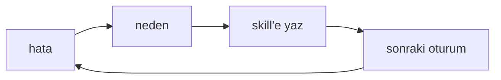
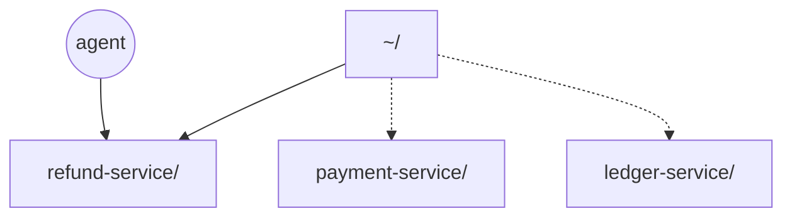
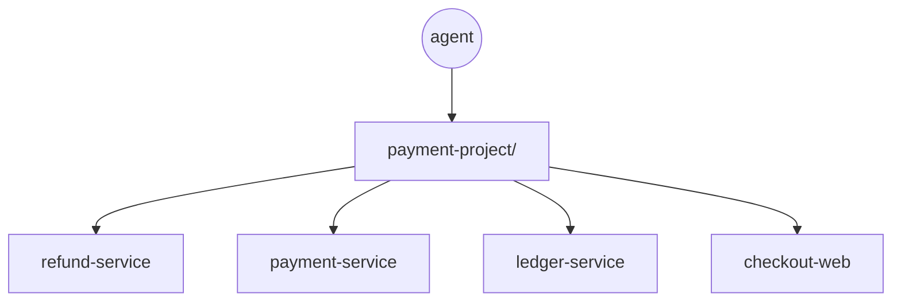

import Ascii from "ascii.rest/astro";

<Ascii
  piece="boot-log"
  mono
  label="Sistem açılış günlüğü: servisler sırayla başlıyor"
  class="kapak-ascii"
/>

Artık çalışırken tek tek kodları onaylamıyorum. AI sessionını açtığımda üstümdeki taskları
Jira'dan kontrol ediyorum ve hangilerinin yapılması gerektiğini söylüyorum.

İlk başta task açıklamalarında eksiklikler var mı, belirlenmemiş ya da atlanmış detaylar
var mı, onlara karar veriyor; yapılacak iş tamamen belli olunca coordinator agent'tan
bunlar için gerekli subagent'ları çalıştırıp taskı yapmasını istiyorum.

AI task için hangi servisler gerekiyorsa bağımlılıklarıyla birlikte ayağa kaldırıyor,
gateway'den token alıyor, bununla authenticate olup backend'i deniyor, frontend'i
agent-browser ile açıp düzgün çalışıp çalışmadığını kontrol ediyor ve değerlerin
database'e düzgün yazıldığına bakıyor. Bir sorun olursa logları inceleyip kendisi yine işi
çözüyor.

Daha iyi bir prompt yazmak, gereksiz tool'ları denemek yerine üzerinde çalıştığı ortamı
agentların daha iyi çalışabileceği şekilde kurmak ve sonrasında feedback'lerle
geliştirmek, sonraki her oturumda yeni bir task'ı yapmayı kolaylaştırıyor. Yapay zekâ,
çalıştığı ortamı ona göre düzenlediğinizde en iyi sonucu veriyor.

Örnek olarak dört servisli bir ödeme sistemini (`payment-project`) kullanacağım. Servis
adları, portlar ve dosya adları temsilî olacak; ama anlattığım yöntemler kendim çalışırken
uyguladığım mekanizmaların aynısı.

## AGENTS.md ve skill dosyaları

AGENTS.md'yi ya da Claude kullanıyorsanız CLAUDE.md'yi bildiğinizi varsayıyorum. Kısaca:
bir dizinde çalışırken AI'ın her oturumun başında sistemine yüklediği dosya. Kalıcı
kurallar ve proje hakkındaki bilgiler genelde burada duruyor; bu da AI'ın her oturumda
sıfırdan bilgisiz başlamasını önlüyor.

Skill'ler benzer ama önemli bir ayrımları var: AI onları isteyince, ihtiyaç duyduğu anda
okuyor. Boştayken neredeyse hiç yer kaplamıyor; AI'ın context'ine sadece dosyanın
başındaki açıklama yükleniyor, belki kısa iki cümle:

```markdown
---
name: refund-flow
description:
  İade talebinin refund-service, payment-service ve ledger-service arasında nasıl
  ilerlediğini anlatır. İade akışına dokunan her değişiklikte oku.
---
```

AI da bu açıklamaya göre, karşılaştığı durumda skill'i çağırıp çağırmamaya karar veriyor.
Yani skill'in işe yaraması, açıklamasının skill'i AI'ın ne zaman çağırması gerektiğini
söylemesine bağlı. "Refund ile ilgili şeyler" iyi bir açıklama değilken, mesela "lokal
ortamı ayağa kaldırırken çağır" gibi bir açıklama daha iyi.

AI'ın ilk başta sadece açıklamaları görüyor olmasının en büyük avantajı skill'leri
olabildiğince spesifik yazmaya imkan vermesi. Yani günün sonunda elinizde 20 tane bile
skill dosyası olsa, içerikleri özgün olduktan sonra zararı olmayacaktır.

AGENTS.md ve skill'ler hakkında uyguladığım kural basit: **bir bilginin tek kaynağı
olacak.** Kalıcı kurallar ve proje hakkındaki genel bilgiler AGENTS.md'de durur;
prosedürler, spesifik yöntemler ve teknolojiler kendi skill'inde durur.

Örnek projede skill listesi böyle görünüyor:

| Skill               | Ne zaman okunur                                                         |
| ------------------- | ----------------------------------------------------------------------- |
| `refund-flow`       | İade akışına dokunan her değişiklikte; üç servis arasındaki sıra        |
| `payment-capture`   | Capture ve pre-auth mantığı değiştiğinde                                |
| `ledger-currency`   | Para birimi ve kur dönüşümü işin içine girdiğinde                       |
| `webhook-signature` | Sağlayıcıdan gelen webhook doğrulanırken; hangi başlık, hangi secret    |
| `db-migration`      | Şemaya alan ya da tablo eklerken; sıra, geri dönüş, seed etkisi         |
| `local-runtime`     | Servisleri ayağa kaldırmak ya da loglara bakmak gerektiğinde            |
| `repo-tests`        | Bir repo'nun testlerini çalıştırmadan önce; hangi komut, hangi baseline |
| `proof-run`         | Kullanıcıya görünen davranışı kanıtlamak gerektiğinde                   |
| `cred-store`        | Kimlik bilgisi, env linki ya da eksik bir anahtar söz konusu olduğunda  |
| `jira-task`         | Task'ın kabul kriterlerini ve Jira geçmişini toplarken                  |
| `ship-path`         | Ortama çıkış, imaj etiketi ve geri dönüş gerektiğinde                   |

Dikkat ederseniz hiçbiri "genel bilgi" değil. Hepsi belli bir durumda okunuyor ve o
durumun dışında okunmadan kalabiliyorlar.

Bir örnek: sağlayıcıdan gelen webhook doğrulanırken `webhook-signature` açılıyor; hangi
başlığın imzalandığını, secret'ın nereden geldiğini ve aynı olayın iki kez işlenmesini
neyin engellediğini anlatıyor. Şemaya alan eklerken `db-migration` açılıyor; migration
sırası, geri dönüşü ve seed verisine etkisi orada yazıyor. Her skill'i olabildiğince
spesifik yapmaya çalışıyorum.

Skill'lerin gövdelerini de kısa tutuyorum: uzun komut listeleri, alan tabloları ve örnek
payload'lar skill'in yanındaki ayrı referans dosyalarında duruyor.

## Hata döngüsü: agent'ın hafızasını yazmak

Aktif bir projede çalışıyorsanız AGENTS.md'nin ve skill içeriklerinin sürekli
güncellenmesi gerekiyor ki bu da ekstra bakım yükü getiriyor. Ben herhangi bir task'ı
bitirdikten sonra, session'ı kapatmadan ya da belki session ortasında, AI'a takıldığı
yerleri not almasını, neden takıldığını çıkarmasını ve bunun bir daha yaşanmaması için
skill'leri ve AGENTS.md'yi güncellemesini söylüyorum:

> takıldığın yerleri not al, neden takıldığını çıkar, bir daha yaşanmaması için skill'leri
> ve AGENTS.md'yi güncelle, gerekiyorsa yeni bir skill oluştur



Bu ufak gibi görünen iş aslında AI için hayati öneme sahip olabiliyor. Çünkü AI çalışırken
basit bir işi bile çoğu zaman üç dört komut denedikten sonra doğrulayabiliyor; bu,
veritabanında bir tablo aramak olabilir, servisleri ayağa kaldırmak olabilir. AI
karanlıkta ilerlediği için deneme yanılma yapıyor ya da bilmediklerini yolda keşfediyor.

Mesela bir task'ta AI bir servisi `npm run start` ile kaldırmayı denemiş, üç komut boşa
gitmiş ve sonunda doğru yolu kendisi bulmuş olsun. Session sonunda `local-runtime`
skill'ine şu iki satır ekleniyor:

```markdown
## Servisleri ayağa kaldırma

- `payment-service`'i `npm run start` ile kaldırma, derleme adımı yok. Script kullan:
  `./scripts/up.sh payment-service`
- Port 8082 doluysa container'ı durdur, `pkill` kullanma.
```

Bir sonraki session'da AI aynı komutu denemiyor, doğrudan script'e gidiyor.

İlk birkaç hafta bu döngü çok fazla değişiklik getirebilir ve gereksiz bir işmiş gibi
gelebilir. Ama zamanla AI'ın yaptığı hataların belirgin şekilde düştüğünü ve deneme
yanılmanın azaldığını göreceksiniz.

Uyguladığım diğer yöntem ise agent'ların yapısı ile ilgili. Ben genelde coordinator bir
agent ve altında worker agent'lar kullanıyorum, maliyeti düşürebilmek ve işlerimi aslında
daha spesifik şekilde yaptırabilmek için. Bir agent'a ne kadar spesifik bir iş verirseniz
sonuç o kadar iyi oluyor.

Tabii coordinator agent, worker agent'ların direkt bütün session konuşmasını görmüyor,
sadece en sonda yazdığı mesajı görebiliyor. Bundan dolayı worker agent'ların sistem
promptlarına şunu ekliyorum:

```markdown
## friction observed

Takıldığın yerleri, sürtünme yaratan yerleri bu başlığın altında raporla.
```

Bu da her worker agent çalıştığında aslında takıldığı yerleri de coordinator'a
bildirmesini sağlıyor.

## Tek repo yetmiyor

Diğer bir konu çalışma dizini. Gerçek bir projede çalışıyorsanız genelde tek bir repoda
çalışmıyorsunuzdur. En az dört beş servisin, bir veritabanının ve dışarıya bağımlılıkların
olduğu bir ortamı hayal etmek daha gerçekçi.

Yaptığım hatalardan bir tanesi, bir repo'nun içine girip session'ı başlatmak ve task'ı
burada yapmaya çalışmak oluyordu. Elbette task, girdiğim repo'yla ilgiliyse (diyelim
`refund-service`) o servisin dizininde çalışmak mantıklı geliyor. Ama burada büyük bir
yanılsama var: çoğu zaman AI'ın dışarıdaki servislere bakması ya da eksik olduğu kısımları
öğrenmesi gerekiyor, bu da o dışarıdaki repo'lara ziyaret anlamına geliyor.



Bu çok büyük bir sorun olmasa da asıl sorun AGENTS.md ve skill dosyalarının güncellenmesi
oluyor. Skill'leri neye göre yaratıp güncelleyeceğim? Tek bir servise göre mi? Diğer
repo'lardaki bilgileri içerecek mi? İçermeyecekse eksik kalacak. İçerirse aynı bilgi
ikinci bir repo'da tekrar edecek, iki hafta sonra biri güncellenip diğeri unutulacak.

AI'ın bunları bilmesi lazım... derken, aslında çalışma ortamımı projedeki bütün servisleri
içeri alacak şekilde bir üst dizine taşımanın çok daha mantıklı olduğunu fark ettim.

## Çalışma alanını bir seviye yukarı taşımak

Böylece AI bütün projeyi çerçeveleyecek, ben de skill'leri hem servislere göre ayrı ayrı,
hem de servislerin birlikte çalışan mantığını aynı dosyada tutabilecektim:



```text
payment-project/
├── AGENTS.md
├── .agents/skills/        # refund-flow, webhook-signature, db-migration…
├── docker/                # compose.yaml + servis başına parçalar
├── scripts/               # build, up, new-task
├── tasks/pay-1234/        # compose.env, task.env, kanıtlar
├── refund-service/
├── payment-service/
├── ledger-service/
└── checkout-web/
```

Örneğin iade akışı tek repo'da bitmiyor: `refund-service` talebi alıyor, `payment-service`
tutarı doğruluyor, `ledger-service` kaydı düşüyor. Artık `refund-flow` skill'i bu üç adımı
ve hangi repo'da ne olduğunu tek yerde anlatıyor; servise özgü detaylar ise kendi skill
dosyalarında kalıyor. Yukarıda bahsettiğim gibi skill yaratmanın neredeyse hiç maliyeti
olmadığı için, biraz fazla skill oluşacak gibi görünse de sorun olmuyor.

Sonuçta ortam, agent'ın tek bir dosyaya değil bütün projeye baktığı bir yer oldu:
skill'ler servisler arası akışı tek yerde anlatıyor, çalışma alanı bütün repo'ları
çerçeveliyor. Geriye servisleri ayağa kaldırmak kalıyor.
