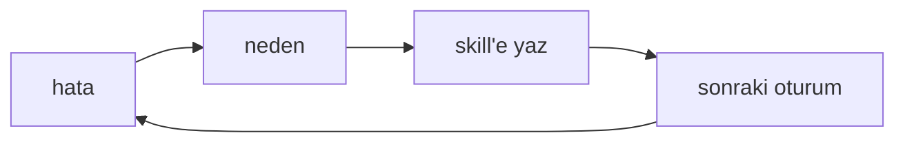
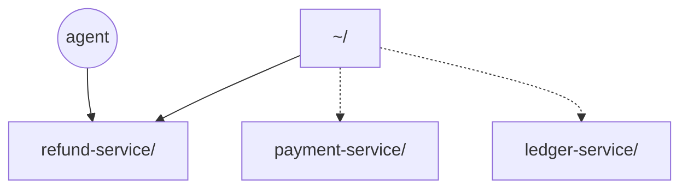
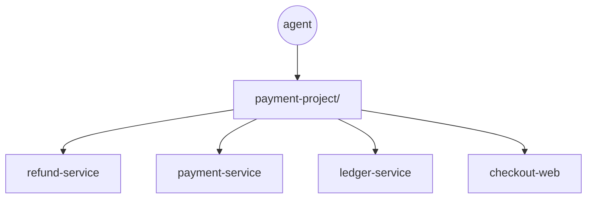
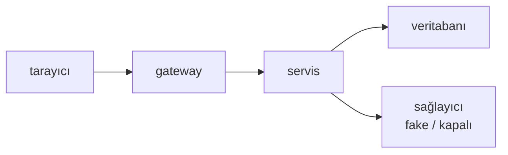
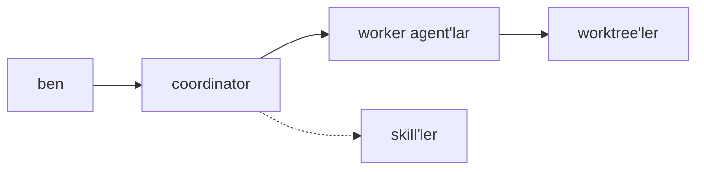
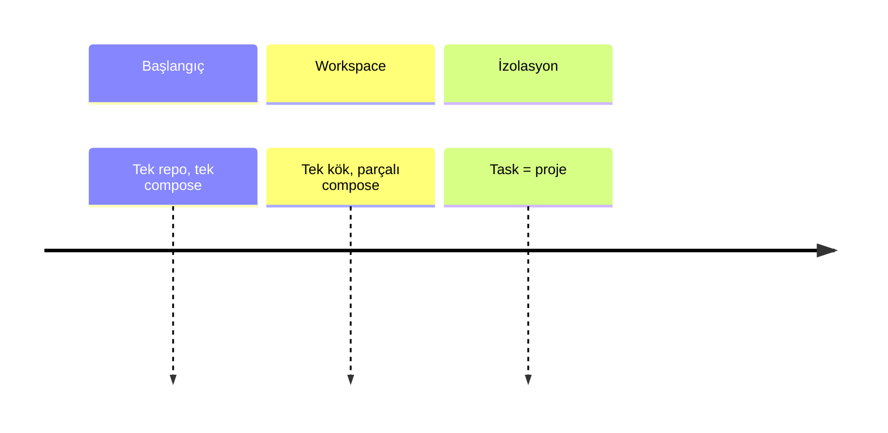

import Ascii from 'ascii.rest/astro';

<Ascii piece="boot-log" mono label="Sistem açılış günlüğü: servisler sırayla başlıyor" class="kapak-ascii" />

Artık çalışırken tek tek kodları onaylamamaya başladım. AI sessionını açtığımda üstümdeki taskları Jira'dan kontrol ediyorum, hangilerinin yapılması gerektiğini söylüyorum.

İlk başta task açıklamalarında eksiklikler var mı, belirlenmemiş ya da atlanmış detaylar var mı, onlara karar veriyor; yapılacak iş tamamen belli olunca coordinator agent'tan bunlar için gerekli subagent'ları çalıştırıp taskı yapmasını istiyorum.

Agent task için hangi servisler gerekiyorsa bağımlılıklarıyla birlikte ayağa kaldırıyor, gateway'den token alıyor, bununla authenticate olup backend'i deniyor, frontend'i agent-browser ile açıp düzgün çalışıp çalışmadığını kontrol ediyor ve değerlerin database'e düzgün yazıldığına bakıyor. Bir sorun olursa logları inceleyip kendisi yine işi çözüyor.

Bu yazı boyunca anlatmak istediğim tek bir durum var: artık AI ile çalışırken darboğaz çoğu zaman model değil ya da maliyet değil, ortam. Daha iyi bir prompt yazmak, gereksiz tool'ları denemek yerine üzerinde çalıştığı ortamı bir kere düzgün kurmak ve sonrasında feedback'lerle geliştirmek, sonraki her oturumu değiştiriyor ve yeni task'ı yapmayı kolaylaştırıyor. Yapay zekâ, çalıştığı ortamı ona göre düzenlediğinizde en iyi sonucu veriyor.

Yazı boyunca örnek olarak dört servisli bir ödeme sistemini (`payment-project`) kullanacağım. Servis adları, portlar ve dosya adları temsilî olacak; lakin anlattığım yöntemler kendi iş yerimde ve projelerimde uyguladığım mekanizmaların aynısı olacak.

## AGENTS.md ve skill dosyaları

AGENTS.md'yi ya da Claude kullanıyorsanız CLAUDE.md'yi bildiğinizi varsayıyorum. Kısaca: bir dizinde çalışırken AI'ın her oturumun başında sistemine yüklediği dosya. Kalıcı kurallar ve proje hakkındaki bilgiler genelde burada duruyor; bu da AI'ın her oturumda sıfırdan başlamasını önlüyor.

Skill'ler benzer ama önemli bir ayrımları var: AI onları isteyince, ihtiyaç duyduğu anda okuyor. Boştayken neredeyse hiç yer kaplamıyor; AI'ın context'ine sadece dosyanın başındaki açıklama yükleniyor, belki kısa iki cümle:

```markdown
---
name: refund-flow
description: İade talebinin refund-service, payment-service ve ledger-service arasında nasıl ilerlediğini anlatır. İade akışına dokunan her değişiklikte oku.
---
```

AI da bu açıklamaya göre, karşılaştığı durumda skill'i çağırıp çağırmamaya karar veriyor. Yani skill'in işe yaraması, açıklamasının skill'i AI'ın ne zaman çağırması gerektiğini söylemesine bağlı. "Refund ile ilgili şeyler" iyi bir açıklama değilken, mesela "lokal ortamı ayağa kaldırırken çağır" gibi bir açıklama daha iyi.

AI'ın ilk başta sadece açıklamaları görüyor olmasının en büyük avantajı şu: skill'leri olabildiğince spesifik yazabilirsiniz. Yani günün sonunda elinizde 20 tane bile skill dosyası olsa, içerikleri özgün olduktan sonra zararı olmayacaktır.

AGENTS.md ve skill'ler hakkında uyguladığım kural basit: **bir bilginin tek kaynağı olacak.** Kalıcı kurallar ve proje hakkındaki genel bilgiler AGENTS.md'de durur; prosedürler, spesifik yöntemler ve teknolojiler kendi skill'inde durur.

Örnek projede skill listesi böyle görünüyor:

| Skill               | Ne zaman okunur                                                         |
| ------------------- | ----------------------------------------------------------------------- |
| `refund-flow`       | İade akışına dokunan her değişiklikte; üç servis arasındaki sıra        |
| `payment-capture`   | Capture ve pre-auth mantığı değiştiğinde                                |
| `ledger-currency`   | Para birimi ve kur dönüşümü işin içine girdiğinde                       |
| `field-contract`    | Bir alan servis sınırını geçtiğinde; hangi servis önce çıkacak          |
| `provider-contract` | Dış ödeme sağlayıcısıyla imza, hata kodu ya da payload değiştiğinde     |
| `agent-graph`       | LangGraph akışına dokunulduğunda; node sırası, state şeması, retry      |
| `prompt-eval`       | Prompt ya da model değiştiğinde; hangi örnek setiyle karşılaştırılacak  |
| `local-runtime`     | Servisleri ayağa kaldırmak ya da loglara bakmak gerektiğinde            |
| `repo-tests`        | Bir repo'nun testlerini çalıştırmadan önce; hangi komut, hangi baseline |
| `proof-run`         | Kullanıcıya görünen davranışı kanıtlamak gerektiğinde                   |
| `cred-store`        | Kimlik bilgisi, env linki ya da eksik bir anahtar söz konusu olduğunda  |
| `jira-task`         | Task'ın kabul kriterlerini ve Jira geçmişini toplarken                  |
| `ship-path`         | Ortama çıkış, imaj etiketi ve geri dönüş gerektiğinde                   |

Dikkat ederseniz hiçbiri "genel bilgi" değil. Hepsi belli bir durumda okunuyor ve o durumun dışında kimse onları açmıyor.

LLM tarafı da aynı mantıkla ayrılıyor. LangGraph ile kurduğumuz bir akışta node sırası, state şeması ve retry davranışı değiştiğinde `agent-graph` açılıyor; prompt ya da model değiştiğinde `prompt-eval` devreye giriyor ve karşılaştırmanın hangi örnek setiyle yapılacağını söylüyor. Skill'lerin gövdelerini de kısa tutuyorum: uzun komut listeleri, alan tabloları ve örnek payload'lar skill'in yanındaki ayrı referans dosyalarında duruyor.

## Hata döngüsü: agent'ın hafızasını yazmak

AGENTS.md'nin ve skill dosyalarının sürekli gelişen bir projede olduğunu düşünürsek bu bilgilerin sürekli güncellenmesi gerekiyor. Bir noktada bakım yükü de demek oluyor bu. Benim en çok kullandığım yöntem herhangi bir task'ı bitirdikten sonra, session'ı kapatmadan ya da belki session ortasında, AI'a takıldığı yerleri not almasını, neden takıldığını çıkarmasını ve bunun bir daha yaşanmaması için skill'leri ve AGENTS.md'yi güncellemesini söylüyorum:

> takıldığın yerleri not al, neden takıldığını çıkar, bir daha yaşanmaması için skill'leri ve AGENTS.md'yi güncelle, gerekiyorsa yeni bir skill oluştur



Bu ufak gibi görünen şey aslında AI için hayati öneme sahip olabiliyor. Çünkü AI çalışırken basit bir işi bile çoğu zaman üç dört komut denedikten sonra doğrulayabiliyor; bu, veritabanında bir tablo aramak olabilir, servisleri ayağa kaldırmak olabilir. AI karanlıkta ilerlediği için deneme yanılma yapıyor ya da bilmediklerini yolda keşfediyor.

Mesela bir task'ta AI bir servisi `npm run start` ile kaldırmayı denemiş, üç komut boşa gitmiş ve sonunda doğru yolu kendisi bulmuş olsun. Session sonunda `local-runtime` skill'ine şu iki satır ekleniyor:

```markdown
## Servisleri ayağa kaldırma

- `payment-service`'i `npm run start` ile kaldırma, derleme adımı yok. Script kullan:
  `./scripts/up.sh payment-service`
- Port 8082 doluysa container'ı durdur, `pkill` kullanma.
```

Bir sonraki session'da AI aynı komutu denemiyor, doğrudan script'e gidiyor.

Daha pahalı bir örnek: AI var olan bir checkout'u güncel sandı; jar build'i `COPY failed: file not found` ile patladı. Hata derlemede çıktığı için ilk yarım saat yanlış yerde arandı; sebep ise üç gün önce alınmış bir clone'du. Not, kabaca şu satıra dönüştü: _build'den önce dalların hedef dalın gerisinde olup olmadığını kontrol et, sıfır değilse build etme._ O günden sonra aynı hata bir daha yaşanmadı.

İlk birkaç hafta bu döngü çok fazla değişiklik getirebilir. Skill dosyaları sürekli değişiyor, bazen aynı kuralı iki kere yazdırabilirsiniz. Ama zamanla AI'ın yaptığı hataların belirgin şekilde düştüğünü ve deneme yanılmanın azaldığını göreceksiniz.

Uyguladığım diğer yöntem ise agent'ların yapısı ile ilgili. Ben genelde coordinator bir agent ve altında worker agent'lar kullanıyorum, maliyeti düşürebilmek ve işlerimi aslında daha spesifik şekilde yaptırabilmek için. Bir agent'a ne kadar spesifik bir iş verirseniz sonuç o kadar iyi oluyor.

Tabii coordinator agent, worker agent'ların direkt bütün session konuşmasını görmüyor, sadece en sonda yazdığı mesajı görebiliyor. Bundan dolayı worker agent'ların sistem promptlarına şunu ekliyorum:

```markdown
## friction observed

Takıldığın yerleri, sürtünme yaratan yerleri bu başlığın altında raporla.
```

Bu da her worker agent çalıştığında aslında takıldığı yerleri de coordinator'a bildirmesini sağlıyor.

## Tek repo yetmiyor

Diğer bir konu çalışma dizini. Gerçek bir projede çalışıyorsanız genelde tek bir repoda çalışmıyor olursunuz. En az dört beş servisin, bir veritabanının ve dışarıya bağımlılıkların olduğu bir ortamı düşünün.

Yaptığım hatalardan bir tanesi, bir repo'nun içine girip session'ı başlatmak ve task'ı burada yapmaya çalışmak oluyordu. Elbette task, girdiğim repo'yla ilgiliyse (diyelim `refund-service`) o servisin dizininde çalışmak mantıklı geliyor. Ama burada büyük bir yanılsama var: çoğu zaman AI'ın dışarıdaki servislere bakması ya da eksik olduğu kısımları öğrenmesi gerekiyor, bu da o dışarıdaki repo'lara ziyaret demek.



Bu çok büyük bir sorun olmasa da asıl sorun AGENTS.md ve skill dosyalarının güncellenmesi oluyor. Skill'leri neye göre yaratıp güncelleyeceğim? Tek bir servise göre mi? Diğer repo'lardaki bilgileri içerecek mi? İçermeyecekse eksik kalacak. İçerirse aynı bilgi ikinci bir repo'da tekrar edecek, iki hafta sonra biri güncellenip diğeri unutulacak.

AI'ın bunları bilmesi lazım... derken, aslında çalışma ortamımı projedeki bütün servisleri içeri alacak şekilde bir üst dizine taşımanın çok daha mantıklı olduğunu fark ettim.

## Çalışma alanını bir seviye yukarı taşımak

Böylece AI bütün projeyi çerçeveleyecek, ben de skill'leri hem servislere göre ayrı ayrı, hem de servislerin birlikte çalışan mantığını aynı dosyada tutabilecektim:



```text
payment-project/
├── AGENTS.md
├── .agents/skills/        # refund-flow, provider-contract, agent-graph…
├── docker/                # compose.yaml + servis başına parçalar
├── scripts/               # build, up, new-task
├── tasks/pay-1234/        # compose.env, task.env, kanıtlar
├── refund-service/
├── payment-service/
├── ledger-service/
└── checkout-web/
```

Örneğin iade akışı tek repo'da bitmiyor: `refund-service` talebi alıyor, `payment-service` tutarı doğruluyor, `ledger-service` kaydı düşüyor. Artık `refund-flow` skill'i bu üç adımı ve hangi repo'da ne olduğunu tek yerde anlatıyor; servise özgü detaylar ise kendi skill dosyalarında kalıyor. Yukarıda bahsettiğim gibi skill yaratmanın neredeyse hiç maliyeti olmadığı için, biraz fazla skill oluşacak gibi görünse de sorun olmuyor.

## Sistemi ayağa kaldırmak

Ortak workspace'e geçince ilgilendiğim diğer konu, servislerin task'a göre ayağa kalkması oldu. İlk akla gelen yöntemle başladım: bütün servisleri tek bir docker compose ile ayağa kaldırmak. Tahmin edileceği üzere çok verimli değildi; her task kendi ihtiyacına göre bir iki servisle halledilebiliyordu. Bunu AI ile deneme yanılma yaparak sürekli geliştirdim, her yeni taskla birlikte efor gerektirmeyen şekilde yapmaya çalıştım: servisleri ayrı ayrı ayağa kaldırılabilecek şekilde tuttum, böylece AI task'a bakıp hangi servislerin kalkması gerektiğini seçiyor ve sistematik bir yöntemle hızlıca kaldırıyor.

Bu ayırmanın bir sonucu da ortamın nerede tarif edildiği oldu: her task'ın kendi klasörü var, `tasks/<task-key>/`. İçindeki `compose.env` hangi checkout'ların ve hangi portların kullanılacağını yazıyor; agent task'a bakıp gereken servisleri seçiyor, yolları da bu dosyadan okuyor. Yani ortam bilgisi komutların içinde değil, task'ın yanında duruyor.

## Uçtan uca çalışmak

Bu yazıda "uçtan uca" dediğim şey şu: sistem ayaktayken bir feature'ı console'dan servise, oradan veritabanına kadar aynı oturumda yürütebilmek. Yani "backend'de şu servisi değiştir" demek zorunda kalmamak; aç, isteği at, kaydı gör, hepsi tek yerde.

Aslında burada yeni bir şey yapılmıyor: bir developer bir feature'ı implemente edince ne yapıyorsa agent da onu yapıyor. Servisleri kaldırıyor, arayüzden geçiyor, isteği atıyor, veritabanına bakıyor, log okuyor. Asıl fark, AI'ın binlerce satır kodu hızlıca yazıp, test edip, logları okuyup, gereken düzeltmeleri yine çok hızlı şekilde yapabiliyor olması.

Benim saatlerimi alacak işler çok daha kısa sürede ama tam anlamıyla da uçtan uca bir şekilde çalıştığı kanıtlanmış bir şekilde benim önüme geliyor.



Eğer frontend ve backend'in karışık olduğu bir sistemde çalışıyorsanız yukarıdaki gibi bir akışa aşinasınızdır. Sağda ufak bir fake olduğunu fark edeceksiniz; evet, gerektiği yerde bütün sistemi yine ayağa kaldırmak yerine gerekenleri fake'lemek çok daha hızlı sonuçlar almanızı sağlıyor.

Bu zamana kadar genelde backend ağırlıklı gittim; frontend'den kısaca bahsedecek olursam, [agent-browser](https://agent-browser.dev) burada hayat kurtarıyor. Açıkçası bunun kadar faydalı çok az şey gördüm. Hangi frontend işim varsa agent-browser ile yaptırıyorum; `playwright`'ın aksine agent-browser tamamen AI için optimize edildiği için çok fazla token harcamadan işi halledebiliyor.

## Paralel çalışma

Bu noktada ortak bir workspace kurup servisleri ayağa kaldırabilen, bir feature'ı implemente edip uçtan uca test edebilen bir AI'ınız varsa ikinci kısma geçebilirsiniz: paralel çalışma.

Hâlihazırda structured bir şekilde sistemi ayağa kaldırabiliyorsunuz; bunu AI'dan önce de yapabiliyordunuz: gerekli servisleri ayağa kaldır, Postman'den istek at, veritabanına bak. Şimdi AI'ın kullanabileceği daha düzgün bir sistem kurdunuz.

Paralel çalışırken en mantıklı yol worktree'lerde çalışmak. Worktree'ler paralelde kod üzerinde çalışmayı kolaylaştırsa da asıl sorun paralel test yaparken çıkıyor. Uçtan uca test ederken iki farklı taskınız varsa ve dört servisli bir sistemde çalışıyorsanız, en az dört artı dört, yani sekiz servisi ayağa kaldırmanız gerekiyor; burada portlardan env dosyalarına kadar ufak tefek ama bir sürü sorun çıkabiliyor. Bunları da karşılaştıkça çözmek en mantıklısı. Ben workspace altında sorunlar çıktıkça ya skill'leri güncelliyorum ya da AI'ın kullanabileceği ufak script'ler yazıyorum. Mesela portları elle seçmek yerine boş portu bulan bir script:

```bash
# 3000'den başlayıp dinleyen ilk boş portu yazdırır
for p in $(seq 3000 3050); do
  lsof -iTCP:"$p" -sTCP:LISTEN -n -P >/dev/null 2>&1 || { echo "$p"; break; }
done
```

AI bu script'i kendi task'ı için çağırıyor, dönen portu `tasks/<task-key>/compose.env` içine yazıyor; böylece "port dolu mu" tahmini ortadan kalkıyor.

Burada **task, ortamın kimliği oluyor.** Aynı servis iki task'ta iki ayrı proje olarak çalıştığı için container adları, portlar, volume'lar ve imaj etiketleri task'ın adından türüyor: `-p pay-1234` ile kalkan yığın `pay-1234`'ün, `-p pay-1250` ile kalkan yığın `pay-1250`'nin. Yani "bu veritabanı hangi işin" sorusunun cevabı container'a bakınca çıkıyor.

İki task yan yana çalışırken `docker compose ps` kısaca şunu gösteriyor:

```text
NAME                     STATUS
pay-1234-postgres-1      healthy
pay-1234-refund-1        healthy
pay-1234-ledger-1        healthy
pay-1250-postgres-1      healthy
pay-1250-checkout-1      healthy
```

| Task'a özel                                       | Paylaşılan                                       |
| ------------------------------------------------- | ------------------------------------------------ |
| Worktree'ler, branch, compose projesi             | Workspace kökü: script'ler, skill'ler, AGENTS.md |
| Portlar, volume'lar, ağlar                        | Ana clone'lar                                    |
| İmaj etiketleri (`payment-<task>-<servis>:local`) | Kimlik bilgisi deposu                            |
| Fake'in sayaçları ve fixture durumu               | deploy hedefi                                    |

İki task asla port, proje adı, veritabanı ya da imaj etiketi paylaşmıyor. Gerçekten paylaşılan şeyler (deploy hedefi, gerçek dış servis) ise sıraya giriyor. Paralel çalışırken AI ile istişare yaparak ilerlemek en faydalı yöntem: hatalar çıktıkça konuşarak, yeni skill'ler yazarak, yeni script'ler oluşturarak bu sorunların çoğunu zamanla aşıyorsunuz.

## Koordinasyon

Ben 2 farklı session'da çalışmayı çok mantıklı bulmuyorum; bundan dolayı coordinator bir agent'la birlikte tek session'da çalışıyorum. Sebebi şu: iki ayrı session, aynı hatayı iki kere öğreniyor. Birinde port çakışması çıkıyor, diğerinde o bilgi yok. Tek coordinator agent ile çalışınca öğrenme tek yerde birikiyor; coordinator subagent'ları gönderiyor, onların yapamadığı yeri görüyor ve skill'e yazıyor. Yani az önceki hata döngüsü, paralel çalışmada daha da değerli hale geliyor.



İkinci sebep daha kişisel: iki pencere arasında gidip gelirken context değiştiriyorum. Hangi işin nerede kaldığını, hangi komutun hangi ortamda çalıştığını kafamda tutmam gerekiyor. Bir süre sonra asıl işi değil, iki işin durumunu takip etmeye başlıyorum. Tek oturumda iş değişse bile aynı yerde kalıyorum; coordinator hangi işin hangi worktree'yi ve hangi portları sahiplendiğini bildiği için çakışma da konuşulacak bir konu olmaktan çıkıyor.

Benzer şekilde worker'ın takıldığı yer de kaybolmuyor: yukarıda bahsettiğim friction raporu her worker çalışmasında coordinator'a dönüyor, coordinator da oradan skill'e bir satır çıkarıyor. Kısacası bütün ortamı geliştirme fırsatlarını da tek yerde toplamış oluyor ve çıkan hataları daha iyi değerlendirip çözebiliyorum.

## Kalite kontrol

Her ne kadar AI her şeyi uçtan uca test ediyor olsa da en son kod farklarını kendim gözden geçirip yine ufak testler yapmam gerekiyor. Özellikle frontend'in dahil olduğu bir task varsa burada gözle kontrol de önemli bir yer kaplıyor.

Başka durumlarda AI her şeyi uçtan uca test etmiş olsa da overengineering yaptığını görebiliyorum; gereksiz logic'ler kurup bunun üzerine yeni feature'ı yazmış olabilir. Basit bir örnek vereyim; gerçekte karşıma çıkan şey bunun çok daha büyüğü oluyor:

```diff
- const strategy = new RefundStrategyFactory()
-   .withRule(new AmountRule())
-   .withRule(new StatusRule());
+ if (amount > order.total) return reject('tutar fazla');
```

Bundan dolayı da task çalışır görünse bile arkada gereksiz ve işi zorlaştıran birçok fonksiyon yazılmış olabilir. Bu konuda yine worker agent'lara belki analiz ettirip üstüne de kendinizin kontrol etmesi daha doğru olur.

## Ne zaman değmez

Bu kurulum her projede kazandırmaz. Ben genelde web servisleri üzerinde çalışan bir yazılımcıyım. Farklı teknolojilerde, farklı sistemlerde bu tarz işlerin işe yarayacağını düşünsem de bir embedded projesinde ne kadar işe yarar, görmüş değilim. Yani mesela orada paralel çalışmak ne demek olur, hiçbir fikrim yok.

## Kapanış

Kısaca bu hale nasıl geldi:



Yazıda en çok eksikliği hissedilen şey elbetteki bu sistemin beni ne kadar hızlandırdığının somut kanıtı. Kendim bunu genelde bir task'ı ne kadar sürede yaptığımdan, ne kadar bug çıktığından ölçmeye çalışıyorum. 4 ay önce 3-4 günümü alan bir task artık 1 günümü pek almıyor. Son çıkan modellerin gerçekten agentic anlamda çok iyi bir seviyeye gelmesinin de etkisi var. Burada bir sayı vermem doğru olmaz, 2x 3x hızlandım gibi, ama söyleyebileceğim tek şey lokal ortamını bu şekilde projeye özgü kurup geliştirdikten sonra task'tan bağımsız olarak işlerin hepsini uçtan uca test etmiş ve kendimden emin bir şekilde teslim edebiliyor olduğum.

Son olarak da şunu belirtmek istiyorum, her ne kadar darboğazın ortamda olduğunu söylesem de bu sadece yazılım kısmıyla ilgiliydi. Eğer yapacağınız iş belirsizse bu sistemin işe yarama ihtimali ya da kazançları da bahsettiğimden çok daha az olur. Büyük resimde yazılım tarafı genelde işin sadece bir tarafını oluşturuyor.
